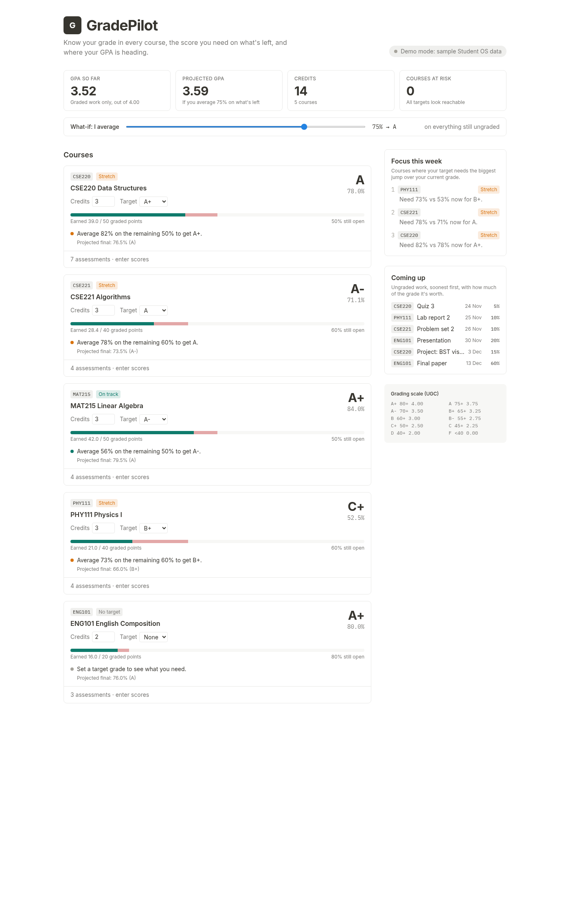

# GradePilot

Grades and GPA for Notion Student OS. GradePilot shows your grade in every course, the score you need on the remaining work to hit your target, and where your GPA is heading.



## The problem

Notion Student OS keeps your courses and assignments in one place, but it can't answer the questions students ask before every exam:

- What's my grade in this course right now?
- What do I need on the final to get an A?
- If I keep scoring like this, what will my GPA be?
- Which course needs the most work this week?

Students usually work this out by hand in a spreadsheet, with every course weighted differently. GradePilot reads the Student OS databases and does the math live.

## Features

- **Per-course grade:** a weighted percent and letter grade based on graded work only, plus a bar that shows points earned, points lost, and the share of the grade still open.
- **What you need:** pick a target grade and GradePilot tells you the average you need on the remaining work. A course is labelled *Locked in*, *On track*, *Stretch*, *At risk*, or *Out of reach*. When the target is out of reach, it shows the best grade you can still get.
- **GPA so far and projected GPA:** credit-weighted on the UGC 4.00 scale used by Bangladeshi universities (A+ 80%+ = 4.00 … F < 40%).
- **What-if slider:** "If I average X% on everything left" updates every projected grade and the projected GPA instantly.
- **Focus this week:** ranks courses by the gap between the grade you need and the grade you have now.
- **Coming up:** ungraded work, soonest first, with how much of the grade each item is worth.
- **Enter scores inline:** type a score (and the "out of"), press Enter or tab away, and it saves to Notion.
- **Set credits and targets per course:** both save to the Courses database.
- **Add assessments:** for example "Final exam, 40%, out of 60". The new page is created in Assignments, linked to the course.
- **One-click setup:** if your Student OS has no Score, Out of, Weight, Credits, or Target grade properties, the **Add grade fields to Notion** button creates them.
- **Demo mode:** with no Notion token, the app runs on a sample semester (CSE220, CSE221, MAT215, PHY111, ENG101), so judges can try it right away.

## How it uses Notion Student OS

GradePilot is a live layer on top of two Student OS databases:

| Database | Properties used |
| --- | --- |
| Courses | Name (title), Code, Status, **Credits** (number), **Target grade** (select A+…F) |
| Assignments | Name (title), Course (relation), Due date, Type, **Score**, **Out of**, **Weight** (numbers) |

Properties in **bold** are added by the setup button if they're missing. Properties are matched by name *and* type, so similar names also work: Marks, Max, Weightage, Credit hours, Goal, and so on. Number formulas and rollups are read too.

- **Reads:** `databases.retrieve` for the schema, then `databases.query` for every page, paginated.
- **Writes:** `pages.update` for scores, credits, and targets; `pages.create` for new assessments (with the Course relation); `databases.update` to add the grade properties.
- **API version:** pinned to Notion-Version `2022-06-28` to match the Student OS template, with a fallback to data sources for newer databases.
- **Server-only:** the Notion token stays on the server. Every read and write goes through Next.js server components and server actions.

### Grade math

- Each assessment counts as `Score / Out of × Weight`. If a course has no weights, all its assessments count equally.
- Current grade = points earned ÷ weight graded so far.
- Needed = (target cutoff × course total − points earned) ÷ remaining weight.
- Projected = (points earned + remaining weight × what-if %) ÷ course total.
- GPA = Σ(credits × grade point) ÷ Σ credits.

## Run it

Requires Node.js 20+.

```bash
npm install
npm run dev
```

Open http://localhost:3000. With no `.env.local`, the app starts in demo mode.

### Connect your Notion Student OS

1. Duplicate the [Notion Student OS](https://app.notion.com/p/campusleaders/Student-OS-Build-Your-Campus-Life-with-Notion-41cd5368c6db80da906ec73c061b3cc6) template if you don't have it yet.
2. Create an internal integration at https://www.notion.so/my-integrations and copy its secret.
3. In Notion, open the Student OS page → **•••** → **Connections**, then add your integration.
4. Copy the URLs of the **Courses** and **Assignments** databases.
5. Set up `.env.local`:

   ```bash
   cp .env.example .env.local
   ```

   ```env
   NOTION_TOKEN=secret_...
   NOTION_COURSES_DB_ID=https://www.notion.so/...   # full URL or 32-char ID
   NOTION_ASSIGNMENTS_DB_ID=https://www.notion.so/...
   ```

6. Run `npm run dev`. The header shows **Connected to Notion Student OS**. If grade fields are missing, click **Add grade fields to Notion**.

### Test it quickly (demo mode)

1. Open a course and click **N assessments · enter scores**.
2. Type a score for an ungraded quiz and press Enter. The grade, the needed %, the GPA, and the focus list all update.
3. Change a course's **Target** to A+ and watch its status change (for example from *On track* to *At risk*).
4. Drag the **What-if** slider to see your projected GPA.
5. Add an assessment such as "Quiz 4, 5%, out of 10".

`npm run build` makes a production build.

## How I used Devin Chat

The whole app was built in a single Devin Chat session, starting from the hackathon brief I pasted in.

- **Idea and scope:** Devin picked a real student problem that Student OS doesn't solve on its own: grade tracking and "what do I need on the final".
- **Repo setup:** Devin created this repository, scaffolded the Next.js + TypeScript + Tailwind project, and reused the Notion patterns from my earlier Student OS project (`2022-06-28` version pinning, name-and-type property matching).
- **Notion integration:** Devin wrote the server-side Notion client: reading the schema, paginated queries, writing scores, credits, and targets, creating assessments, and auto-adding missing properties with `databases.update`.
- **Grade engine:** Devin wrote the weighted grade, needed-score, projection, and GPA functions on the UGC scale.
- **UI:** Devin built a Notion-style dashboard with stat cards, the what-if slider, course cards, inline score editing, focus and upcoming panels, and toasts with optimistic updates.
- **Testing:** Devin ran a production build, then drove the app in a browser: it saved a score, added an assessment, changed a target, and reloaded to confirm the changes stuck.

## Tech stack

- Next.js 16 (App Router, server actions) + React 19 + TypeScript
- Tailwind CSS 4
- `@notionhq/client` (server-side only)

## License

MIT
